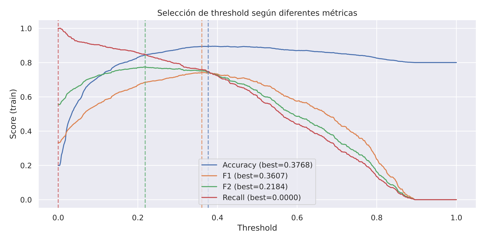
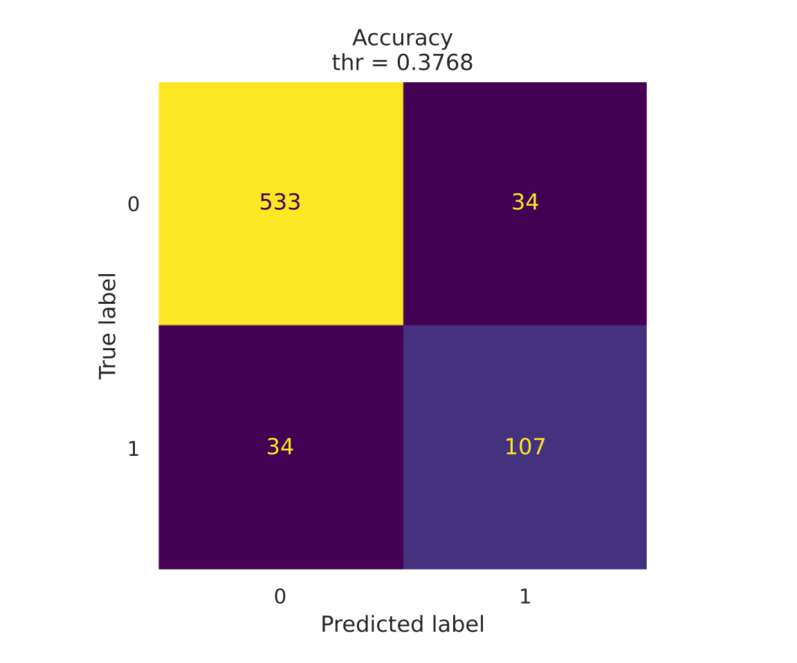

# Predicción de fuga de clientes (churn)

Ejercicio completo de clasificación binaria sobre un problema de churn en
telecomunicaciones, del CSV crudo a la comparación final de modelos. Módulo de *Minería
de datos y Modelización Predictiva* del Máster en Big Data, Data Science e IA de la
Universidad Complutense (curso 2025-26).

## El umbral

Aquí el 0,5 por defecto no vale. Perder un cliente cuesta mucho más que mandarle una
campaña de retención que no necesitaba, y una vez deduplicado el dataset las clases están
desbalanceadas (2.832 / 706), así que lo que hay que ajustar es dónde se corta la
probabilidad. Barriendo umbrales, el mejor F1 aparece
en **0,36**.





## Los datos

El CSV trae **9.200 filas, de las que 5.662 son duplicados exactos**, y en ese estado las
clases quedan artificialmente igualadas a 4.600 / 4.600. Deduplicado quedan **3.538 filas
con un 20 % de fuga (2.832 / 706)**, y ése es el dataset sobre el que corre todo el
modelado. El desbalanceo —y por tanto el problema del umbral— **aparece al limpiar**: en
el dato crudo no se ve.

20 variables predictoras anonimizadas (`V1`–`V20`) y una objetivo binaria `Y`:
comportamiento de uso, información geográfica y características del plan contratado.

## Lo que hice, por orden

1. **Duplicados.** Detectados y tratados, manteniendo en paralelo la versión con y sin
   duplicados para medir su efecto real sobre las métricas.
2. **Valores perdidos.** *Heatmap* y correlación de nulos para distinguir un patrón MCAR
   de uno estructurado. Imputación por mediana/moda con `SimpleImputer` ajustado **solo
   sobre train**; si se ajusta sobre todo el dataset, el test ya está contaminado.
3. **Valores extremos.** Doble criterio, rango intercuartílico e `IsolationForest`,
   comparando qué marca cada uno antes de decidir.
4. **PCA y clustering.** Reanálisis con 2 componentes y caracterización de segmentos de
   cliente.
5. **Modelado.** Dos *pipelines* que terminan los dos en un **perceptrón multicapa** y que
   sólo se diferencian en cómo eligen las cinco variables: uno con `RFE` sobre una
   regresión logística, el otro con `SelectFromModel` sobre un árbol. La logística y el
   árbol son **selectores, no clasificadores**. *Grid search* y validación cruzada
   estratificada sobre cada uno.
6. **Umbral y comparación final.** El barrido de arriba, más *boxplots* de la distribución
   de métricas entre configuraciones, importancia de variables e intervalos de confianza.

## Qué hay en el repo

| Ruta | Contenido |
|---|---|
| `notebooks/churn_clasificacion.ipynb` | Análisis completo, de la carga de datos a la comparación final. |
| `data/BBDD_ML_TAREA.csv` | Dataset de partida (9.200 × 21 en crudo; 3.538 tras deduplicar). |
| `docs/memoria_pca_clustering.pdf` | Memoria escrita: PCA, clustering y comparación de predicciones. |
| `scripts/funciones_auxiliares.py` | Funciones reutilizadas por el notebook. |
| `figuras/` | Matrices de confusión, selección de umbral e importancia de variables (SVG). |

```bash
python -m venv .venv && source .venv/bin/activate
pip install -r requirements.txt
jupyter lab notebooks/churn_clasificacion.ipynb
```

Python, pandas, scikit-learn, Matplotlib y Seaborn.
